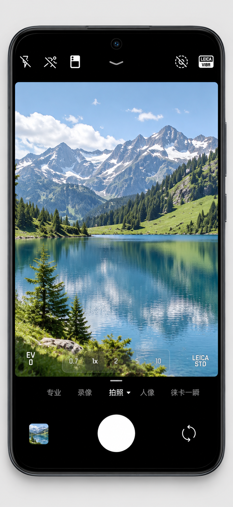
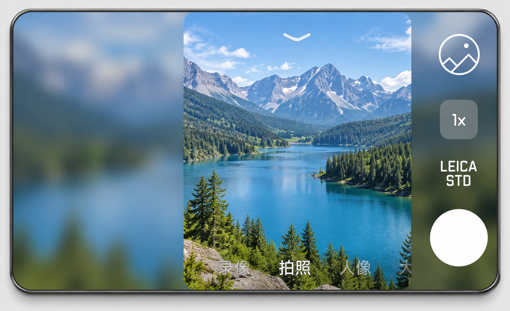
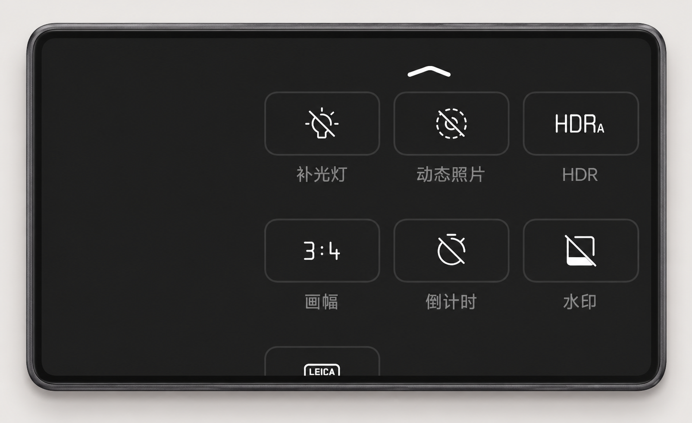
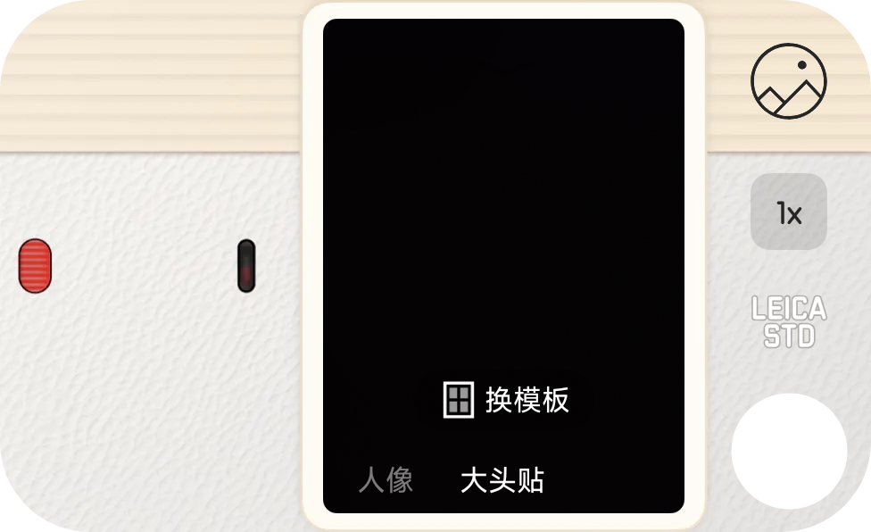

# 徕卡相机移植修复

适用于 **小米 17 Pro / 17 Pro Max 背屏**的徕卡移植相机 LSPosed 补丁。Pro Max 已实机验证；17 Pro 已加入原厂配置与硬件识别，尚未实机验证。保留相机原生控制器和操作逻辑，修正背屏布局、徕卡界面风格、变焦/滤镜适配，并恢复主屏背屏预览按钮的原厂位置。

**当前版本：1.2.1** · [下载 APK](https://github.com/ziyuan-404/leica-camera-port-fix/releases/tag/v1.2.1-native)

## 适用范围

| 项目 | 已验证环境 |
| --- | --- |
| 设备 | 小米 17 Pro Max，代号 `popsicle`，型号 `2509FPN0BC` |
| 系统 | HyperOS `OS4.0.4.0.XPBCNXM`（1.2.1 本轮验证） |
| 基础移植模块 | **Leica camera 0.229 / build229，KernelSU 版**（1.1 为 0.225，旧版见历史记录） |
| 模块 ID | `leica_camera_nezha28` |
| 相机 | `com.android.camera`，`6.6.000570.5` / `660005705` |
| 框架 | KernelSU、Zygisk、LSPosed；本补丁仅勾选相机 |

背屏修复根据系统实际枚举的内置副屏启用，不依赖 `Build.DEVICE`、营销名称或 Device Faker 的产品属性。17 Pro 的 904×572 背屏对应 `Pandora` 原厂配置，Pro Max 的 976×596 背屏对应 `Popsicle`。主屏、投屏、HDMI 和虚拟显示不触发；未知背屏规格暂不套用其他机型配置。相机版本限制仍适用。

1.2.1 恢复主屏/背屏 12.5M 与 50M、主屏人像 2×、本机焦段表和顶部原生 ESP 入口；人像不再显示 ESP 按钮。经系统原厂相机实测对照，拍照 2× 保持 2×，人像 2× 在 46/75mm 之间切换；标签显示与计时由相机控制。

这是基础移植模块的附加修复 APK

## 基础移植模块的来源

本补丁基于使用者提供并已安装的 **`Leica-camera-0.219-build219-KernelSU.zip`** 适配。该 ZIP 内 `module.prop` 声明：

- 名称：`Leica camera`
- 作者：**酷安 kobbin**
- 版本：`0.219` / `219`
- 模块 ID：`leica_camera_nezha28`
- 配套适配器包名：`com.kobbin.leicaflavor`

本仓库由 `ziyuan-404` 维护，发布的是**附加修复补丁**，不是 kobbin 的官方仓库；不重新分发基础模块 ZIP、原相机 APK、OTA、厂商库或原厂水印资源。小米、徕卡名称与相关资源归各自权利人所有。

## 界面展示

以下展示图来自早期版本；**0.10 的背屏效果入口与滤镜列表已恢复原厂组件，旧图中的徕卡滤镜入口不代表当前版本**。

图片以修复后的实机界面为参考制作，**取景画面及相册缩略图已替换为示例风景**。边框为展示示意，不是手机实物照片；AI 编辑图用于展示布局与风格，不作为像素级测试证据，也不表示实际相机成像质量。


<table>
  <tr>
    <td width="35%" align="center">
      <br>主屏与背屏预览入口
    </td>
    <td width="65%" align="center">
      <br>背屏取景与外围实时模糊<br><br>
      <br>背屏下拉菜单
    </td>
  </tr>
</table>

<table>
  <tr>
    <td width="50%" align="center">
      <br>大头贴滤镜选择菜单
    </td>
    <td width="50%" align="center">
      <br>大头贴拍摄界面
    </td>
  </tr>
</table>

## 修复内容与操作

- 背屏下拉菜单使用原生三列布局，可上下滚动；保留相机原生展开、选中、收起与返回流程。
- 菜单使用徕卡纯色底板与图标；保留略加宽的圆角矩形细边框，增加图标边框与标签的留白。展开选中项沿用主屏灰底；滤镜使用徕卡红框。
- 实时模糊用于取景区域以外的填充。
- 背屏拍照效果完整复用相机内置原厂分支：魔棒入口、滤镜／美颜两个标签，以及原图、奶油、清新等原生滤镜；仅保留徕卡配色。撤掉之前对滤镜尺寸、圆角、间距、标题位置、点击和滚动的自定义改写。
- 点选或滑动选中滤镜后，点清晰预览画面关闭，再打开仍保留选择；左侧模糊背景沿用原厂行为，不作为关闭区域。主屏滤镜保持徕卡分支。
- 恢复本机变焦能力，处理其他 hook 把倍率限制在 0.7–1×、造成标签与画面不一致的问题。保留原生倍率点击、长按刻度和拖动算法。
- 1.1 恢复配套的人像原生 Smart FOV 倍率表，修复 2× 后请求 5× 被拒绝而卡住的问题；人像按 0.7、1、1.2、1.5、2× 循环。大头贴保持原生 0.7、1、2、5× 循环、长按及拖动。
- 修复启用条件改为真实背屏硬件识别，伪装成 `nezha` 仍可使用对应本机配置。清理旧适配器监听器屏蔽、停用的 UI 调试导出和未使用字段；保留必要的原生提供器初始化。
- 恢复原生大头贴能力入口；完整背屏相机模式为录像、拍照、人像、大头贴。
- 补光灯常亮和大头贴的菜单背景跟随原生浅色主题，修复深色图标叠在固定深灰底板上看不清的问题。
- 恢复主屏/背屏拍照菜单的 12.5M 与 50M 选项，以及主屏人像 1/2/5× 档位。
- 撤掉主屏背屏预览按钮的同行位置修改，恢复原厂顶部入口；隐藏基础模块额外创建的同行入口，人像模式不显示 ESP。
- 保留原生徕卡水印模板的 Logo 兼容修复，资源在设备上从已安装相机读取。

### 两个背屏入口

**主屏“背屏预览”按钮**原生相机逻辑：前后同时预览，背屏显示简化画面，点击背屏拍照。
**独立启动的完整背屏相机**提供相册、变焦、效果、快门、模式栏和下拉菜单；点击取景区域对焦。两种入口保留各自原有行为。

画幅更改后，画幅选项收起，**返回上一级下拉菜单，菜单仍保持打开**。菜单打开时，返回键先收起展开项，再收起菜单。

### 0.10 验证范围

已在上表设备及模块实测：奶油点选、清新滑动选择，关闭／重开后保留；滤镜列表可滑到末端并返回原图；魔棒和滤镜／美颜标签可切换。冷启动会重置滤镜，未改写启动保留策略。

复用的是**移植相机 6.6 自带的原厂组件**，不是把系统原厂 6.7 APK 整体移入。两个版本的资源存在差异，不保证与系统 6.7 截图逐像素一致。详见[本轮验证记录](docs/verification-0.10.md)。

## 安装与更新

1. 先确认基础移植模块版本和相机版本与上表一致，基础相机本身能正常使用。
2. 从 [1.2.1 Release](https://github.com/ziyuan-404/leica-camera-port-fix/releases/tag/v1.2.1-native) 下载并安装 `Leica-Camera-Fix-1.2.1.apk`。
3. 在 LSPosed 启用 **Leica Camera Fix**，作用域只选 `com.android.camera`（相机）。
4. 强制停止并重新打开相机；如框架尚未加载新补丁，再重启手机。

APK 包名为 `local.leica.watermarkfix`。已有本项目同签名旧版可覆盖更新；自行编译使用自己的签名，不能直接覆盖已安装的发布版。需要撤销时，在 LSPosed 禁用本补丁并重启相机；基础移植模块不会随此操作卸载。


## 从源码构建

使用 JDK 17、Gradle 8.13、Android SDK Platform 35 / Build Tools 35.0.0。版本组合见 [Android Gradle Plugin 8.12 官方兼容说明](https://developer.android.com/build/releases/agp-8-12-0-release-notes)。配置 `ANDROID_HOME` 或本地 `local.properties` 后执行：

```sh
gradle --no-daemon assembleDebug
```

Xposed API 82 为 `compileOnly`，不会打包进补丁。CI 对源码执行相同构建。发布版使用维护者本地私钥签名，私钥不在仓库中；源码构建产物与发布 APK 的签名及字节哈希不同。

源码入口：[WatermarkFix.java](src/local/leica/watermarkfix/WatermarkFix.java)、[RearMenu.java](src/local/leica/watermarkfix/RearMenu.java)。
